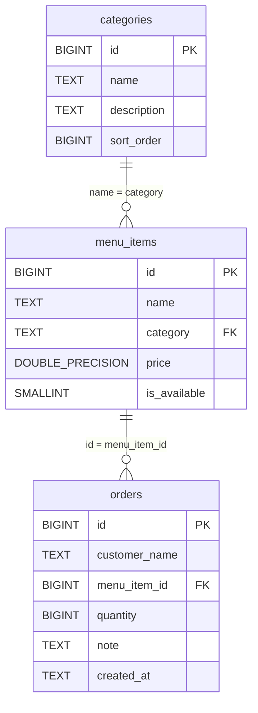

# Database schema — Coffee Corner

หน้าเว็บอ่านเมนูและบันทึกออเดอร์ใน Supabase PostgreSQL ผ่าน `@supabase/supabase-js` โดยใช้ publishable key จาก `.env.local` ส่วน `../data/schema.sql` และ `../data/coffee.db` เป็นข้อมูล SQLite เดิม ไม่ใช่ฐานข้อมูลที่หน้าเว็บใช้งาน

## ER diagram

`||--o{` หมายถึงรายการฝั่งซ้ายหนึ่งรายการเชื่อมกับรายการฝั่งขวาได้ศูนย์รายการขึ้นไป โดยแต่ละรายการฝั่งขวาต้องเชื่อมกับฝั่งซ้ายหนึ่งรายการ

## คอลัมน์ของแต่ละตาราง

### `categories` — หมวดเครื่องดื่ม

| ชื่อ | ชนิดข้อมูล | คำอธิบาย |
| --- | --- | --- |
| `id` | `BIGINT` | รหัสหมวด (PK) |
| `name` | `TEXT` | ชื่อหมวด ห้ามว่าง และไม่ซ้ำ; ถูกอ้างอิงโดย `menu_items.category` |
| `description` | `TEXT` | คำอธิบายหมวด; เว้นว่าง (`NULL`) ได้ |
| `sort_order` | `BIGINT` | ลำดับการแสดงหมวด ห้ามว่าง |

### `menu_items` — รายการเครื่องดื่ม

| ชื่อ | ชนิดข้อมูล | คำอธิบาย |
| --- | --- | --- |
| `id` | `BIGINT` | รหัสเมนู (PK) |
| `name` | `TEXT` | ชื่อเมนู ห้ามว่าง และไม่ซ้ำ |
| `category` | `TEXT` | ชื่อหมวด (FK → `categories.name`) ห้ามว่าง; ถ้าเปลี่ยนชื่อหมวดจะอัปเดตตาม และลบหมวดที่ยังถูกใช้งานไม่ได้ |
| `price` | `DOUBLE PRECISION` | ราคา ต้องมากกว่า 0 และห้ามว่าง |
| `is_available` | `SMALLINT` | สถานะขาย: `1` = มีขาย, `0` = หมด/ไม่เปิดขาย; รับเฉพาะ 0 หรือ 1 และห้ามว่าง |

### `orders` — ออเดอร์

| ชื่อ | ชนิดข้อมูล | คำอธิบาย |
| --- | --- | --- |
| `id` | `BIGINT` | รหัสออเดอร์ (PK) |
| `customer_name` | `TEXT` | ชื่อผู้สั่ง 1–80 ตัวอักษรหลังตัดช่องว่างหัวท้าย |
| `menu_item_id` | `BIGINT` | รหัสเมนูที่สั่ง (FK → `menu_items.id`) ห้ามว่าง |
| `quantity` | `BIGINT` | จำนวนแก้ว ตั้งแต่ 1 ถึง 5 และห้ามว่าง |
| `note` | `TEXT` | หมายเหตุเพิ่มเติม สูงสุด 200 ตัวอักษร; เว้นว่าง (`NULL`) ได้ |
| `created_at` | `TEXT` | เวลาสร้างออเดอร์; ออเดอร์ใหม่ใช้ค่าเริ่มต้นเป็น UTC ISO 8601 |

## ความสัมพันธ์แบบเข้าใจง่าย

- หมวดหนึ่งมีเครื่องดื่มได้หลายเมนู (หรือยังไม่มีเลย) แต่ทุกเมนูต้องอยู่ในหมวดหนึ่ง โดยอ้างชื่อหมวด ไม่ใช่รหัสหมวด
- เครื่องดื่มหนึ่งเมนูถูกสั่งได้หลายออเดอร์ (หรือยังไม่ถูกสั่ง) แต่ออเดอร์แต่ละรายการอ้างถึงเมนูเดียวและเก็บจำนวนแก้วไว้ในรายการนั้น
- ทุกตารางเปิด Row Level Security (RLS): ผู้ใช้ไม่ล็อกอินอ่านหมวด เมนู และออเดอร์ทั้งหมดได้ และเพิ่มออเดอร์ของเมนูที่ยังขายได้เท่านั้น
- บทบาทของหน้าเว็บไม่มีสิทธิ์แก้ไขหรือลบข้อมูลในตาราง; หน้า `/orders` เปิดเผยชื่อและหมายเหตุของออเดอร์ทั้งหมดต่อผู้เข้าชม
